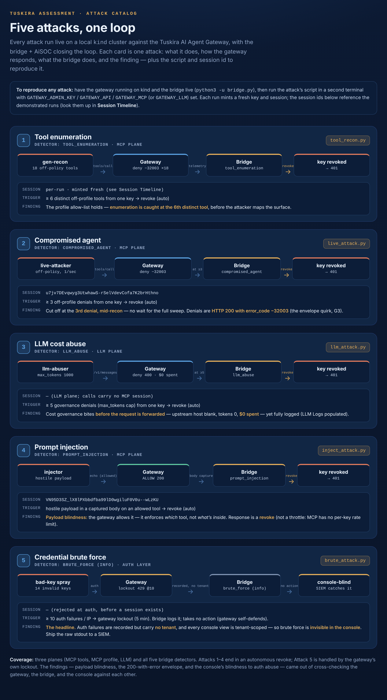

# Tuskira AI Agent Gateway — Hands-On Security Assessment

An independent, hands-on security assessment of the open-source
**[Tuskira AI Agent Gateway](https://github.com/Tuskira/ai-agent-gateway)** —
run from a SOC analyst's perspective. It drives realistic adversarial traffic
through a local instance of the gateway, verifies which controls actually fire,
feeds the gateway's own telemetry to a reactive SIEM and a proactive threat
hunt, executes containment through the gateway's API, and documents both the
strengths and the observability gaps.

Everything here runs against a **local** instance bound to `127.0.0.1`, uses
**synthetic** identities and [TEST-NET](https://datatracker.ietf.org/doc/html/rfc5737)
IPs (`198.51.100.0/24`, `203.0.113.0/24`), and spends **nothing** on LLM calls
(a local mock upstream stands in for a real model). No real data, keys, or
production systems are involved.

> **Scope note.** This is a black/grey-box functional security assessment of a
> tool's controls — not an exploit dump. The "gaps" below are design and
> observability observations about an open-source product, surfaced by testing
> it the way a SOC would before relying on it. See
> [Responsible disclosure](#responsible-disclosure).

---

## Live demonstration



Five adversarial scenarios were run **live** against the gateway on a local
`kind` cluster, with a bridge + AiSOC closing a real detect → investigate →
respond loop. Four end in an **autonomous** key revoke (the attacker's next call
comes back `401`); the fifth is handled by the gateway's own lockout. Full
catalog, per-attack reproduce steps, and session ids:
**[docs/attacks.md](docs/attacks.md)**.

More diagrams in [`assets/`](assets/): the architecture loop
([detect-respond-loop](assets/detect-respond-loop.png)), a step-by-step
walkthrough ([containment-walkthrough](assets/containment-walkthrough.png)), and
a one-glance version ([containment-at-a-glance](assets/containment-at-a-glance.png)).
The live build is in **[docs/live-build.md](docs/live-build.md)**; the design in
**[docs/live-deployment.md](docs/live-deployment.md)**.

---

## Why test an AI-agent gateway at all?

AI agents are a new and fast-growing attack surface, and they are unusual in a
way that matters to a SOC:

- **They act with real credentials and real tools.** An agent reads files,
  calls APIs, runs tools (via MCP), and talks to LLMs — all with delegated
  authority. A stolen or hijacked agent identity is a stolen set of hands.
- **Traditional SOC tooling is blind to them.** A SIEM, EDR, or WAF has no
  native concept of *"which agent is doing what, with which tool, on whose
  behalf."* Agent activity doesn't look like a user session or a process tree.
- **An AI-agent gateway is the chokepoint that fixes this.** It sits in front
  of every agent action — tool calls (MCP) and model calls (LLM) — so it is
  the one place that can both **see** every action (observability) and **stop**
  it in real time (enforcement), and the **hands** that carry out containment.

If you're going to put a gateway on that critical path, you need to know its
controls actually work, how its telemetry feeds the SOC, and where its blind
spots are. That's what this assessment does.

---

## The three-tool model

The assessment exercises the gateway as the centre of a small detection-and-
response system:

| Role | Tool | What it does |
|---|---|---|
| **Eyes + enforcement + hands** | **The gateway** (Tuskira) | Sits on the live path; allows / denies / caps in real time, records every action, and executes containment via its control-plane API. |
| **Reactive brain** | **AiSOC** ([beenuar/AiSOC](https://github.com/beenuar/AiSOC)) | Reads the gateway's telemetry, correlates it into incidents, and proposes containment (DETECT → TRIAGE → HUNT → RESPOND). |
| **Proactive brain** | **The hunt** (ATHF-style) | Asks hypotheses over the same telemetry to find patterns no single alert would catch (e.g. tool enumeration). |

The loop is always the same: **gateway sees & acts → AiSOC or hunt reads &
decides → the recommendation is executed back on the gateway.**

---

## What was tested

Capability coverage across both planes (MCP + LLM):

| Gateway capability | Exercised by | Result |
|---|---|---|
| API-key auth + per-IP lockout | Example 1 (brute force) | ✅ bad keys → `401`, IP → `429` lockout |
| Per-agent authorization (profiles) | Examples 1 & 5 | ✅ off-profile tool → `-32003` |
| Egress / SSRF guard | Example 3 | ✅ metadata IP (+ decimal/hex) → `400 egress_blocked` |
| Hostile-content capture | Example 2 (prompt injection) | ✅ passed (`200`) but fully captured |
| LLM token / cost / rate governance | Example 4 | ✅ oversized `400`, rate `429`, budget `429` — before any paid call |
| Observability / telemetry | all | ✅ routed actions logged + attributed · ⚠️ auth failures recorded but **not shown in the tenant-scoped console** (G1) |
| Response actuator (revoke / tighten) | Attacks 1–4 (live loop) | ✅ `DELETE /api-keys` → agent's next call `401`, autonomously |
| Credential vaulting / injection | Example 6 (secret injection) | ✅ injected at the edge; agent never holds or can read it |

The six adversarial scenarios, each mapped to the detect-and-respond flow:

| # | Scenario | Plane | Detector | Headline |
|---|---|---|---|---|
| 1 | Compromised agent + credential brute force | MCP | AiSOC | gateway enforces & records → SIEM builds one incident → revoke |
| 2 | Prompt injection via an allowed tool | MCP | AiSOC | gateway **passes** content it can't judge, but captures it → SIEM catches it |
| 3 | SSRF / credential theft | MCP (control) | — | gateway **blocks at the door**; never reaches the network or SIEM |
| 4 | LLM resource abuse ("LLM-jacking") | LLM | AiSOC | gateway **meters & caps** by key before any paid call → SIEM flags cost harvesting |
| 5 | Tool enumeration / permission discovery | MCP | **hunt** | quiet per call, loud in aggregate → proactive hunt confirms |
| 6 | Secret injection (credential vaulting) | LLM | — | gateway injects a vaulted credential the agent never sees or can steal |

These bench scenarios were then re-run **live on `kind` as five attacks** with
the containment executed **autonomously** by the bridge — see the
[live attack catalog](docs/attacks.md). The loop-closed result: the containment
each attack triggers (`gateway.apikey.revoke`) is executed against the gateway
API, and the revoked key's next request comes back `401` — in seconds, no human
in the path.

MITRE mappings used: ATT&CK **T1069 / T1078 / T1110 / T1496 / T1613 / T1059**
and ATLAS **AML.T0034 (cost harvesting) / AML.T0051 (prompt injection) /
AML.T0054 (jailbreak)**.

---

## Key findings

The gateway is a genuinely strong control point: it closes the agent-visibility
blind spot, enforces authorization, egress, and LLM cost/rate limits *on the
live path*, vaults credentials so agents never hold them, and exposes a
control-plane API that turns detection into real containment.

A SOC-minded assessment also names the gaps. The notable ones:

- **The console cannot show authentication abuse (the headline).** Auth failures
  and the IP lockout *are* recorded to the telemetry stream — but those records
  carry **no tenant and no key id** (auth failed before a principal), and every
  console view is **tenant-scoped**, so they're silently dropped from Access
  Logs, Overview, Session Timeline. The brute force (Attack 5) was invisible in
  the console yet fully present in the raw feed (the bridge detected it there).
  Treat the gateway as a **telemetry source, not a security console** — ship its
  stdout to your SIEM.
- **API-key lifecycle isn't audited.** A revoke is a soft-delete; the key shows
  `Revoked`, but the *action* leaves no event — who/when/why live only in your
  SOAR layer's audit log.
- **Denials are `HTTP 200` with an `error_code`.** Alert on `error_code`
  (`-32003`), not HTTP status.
- **Payload blindness + MCP has no per-key rate limit.** The gateway enforces
  *which* tool, not the payload — so an injection rides through an allowed tool
  (`200`); and `rpm` is enforced only on the LLM plane, so an MCP attacker needs
  a **revoke**, not a throttle.
- **The IP lockout's `X-Forwarded-For` trust is config-critical.** The default is
  safe (spoofed XFF ignored — confirmed live), but a too-broad `trusted_proxies`
  is bypassable.

> The detect → investigate → respond loop here ran **live and autonomous** for
> low-blast-radius actions — not batch, not human-gated. (An earlier draft's
> claim that auth `401`s are "not recorded" was wrong; the corrected finding —
> recorded but console-invisible — is sharper. See findings.md.)

Full detail with evidence: **[docs/findings.md](docs/findings.md)**.

---

## Reproduce it

**The live demonstration (on `kind`, with the autonomous loop)** is the primary
path: build it with **[docs/live-build.md](docs/live-build.md)**, then run the
five attacks per **[docs/attacks.md](docs/attacks.md)**. That's where the
findings in this repo came from.

The original bench scenarios (Docker Compose, after-the-fact analysis) are in
**[docs/runbook.md](docs/runbook.md)**. The short version of that path:

**Prerequisites:** Docker + `docker compose`, Python 3, `curl`, `jq`, Node
(`npx`), and a local clone of the
[gateway repo](https://github.com/Tuskira/ai-agent-gateway). For Examples 4 & 6,
the mock upstream reaches the gateway on `host.docker.internal`.

```sh
# 1) bring the gateway up with analytics + bodies (from the gateway repo)
GATEWAY_SINKS_CLICKHOUSE_ENABLED=true GATEWAY_SINKS_STDOUT_INCLUDE_BODIES=true \
  docker compose -f deploy/docker-compose.yml --profile analytics up -d

# 2) register the reference MCP tool server
PORT=23014 npx -y @modelcontextprotocol/server-everything streamableHttp &
#    ...and register it as the "everything" connector (see docs/runbook.md)

# 3) export your admin key and start the telemetry tail
export GATEWAY_ADMIN_KEY=gk_...
./scripts/ship.sh &          # tails both planes into ~/bench/gateway-events.jsonl

# 4) run a scenario, e.g. Example 1 (compromised agent + brute force)
python3 scripts/gw_traffic.py --baseline 12 --probes 10 --spike 60 --bruteforce 16
python3 scripts/adapt.py                         # build the AiSOC scenario
aisoc-sandbox demo --file ~/bench/scenario.json  # investigate it
```

Each scenario's exact commands and what to look for on the console are in the
runbook.

---

## Repository layout

```
tuskira-gateway-assessment/
├── README.md                 this file
├── docs/
│   ├── attacks.md            the five live attacks — catalog + reproduce
│   ├── findings.md           strengths + gaps, with live evidence
│   ├── live-build.md         build the live kind + bridge + AiSOC loop (M0–M6)
│   ├── live-deployment.md    the live-system design (architecture, bridge)
│   └── runbook.md            original bench scenarios (Docker Compose)
├── assets/                   the four diagrams (.png for GitHub, .html sources)
├── bridge/
│   ├── bridge.py             the live detect-and-respond loop (~350 LOC, stdlib)
│   └── README.md             how the bridge runs, its detectors and responses
└── scripts/
    ├── tool_recon.py         Attack 1  tool enumeration
    ├── live_attack.py        Attack 2  compromised agent (persistent)
    ├── llm_attack.py         Attack 3  LLM cost abuse (max_tokens, $0 spent)
    ├── inject_attack.py      Attack 4  prompt injection through an allowed tool
    ├── brute_attack.py       Attack 5  credential brute force → lockout
    ├── ship.sh               tail gateway telemetry into one feed (both planes)
    ├── ssrf.sh               bench  SSRF / egress guard
    ├── secret_demo.py        bench  secret injection / credential vaulting
    └── …                     other bench helpers (gw_traffic, adapt*, hunt*, …)
```

All scripts are pure Python/bash standard library, take `GATEWAY_ADMIN_KEY`
(and the `GATEWAY_API/MCP/LLM` endpoints) from the environment, and target
`localhost` only. The live attacks target the `kind` ports (`:28081/:28080/:28082`).

---

## Responsible disclosure

The gaps documented here were observed on a **local** instance of an
open-source tool. They are design/observability observations, not weaponised
exploits. Before this repository is made public, the observability findings
should be shared with the vendor (`security@tuskira.ai`) so they can respond
first. The repository is intended to be kept **private** until then.

Nothing in this repo contains real credentials: every key is read from the
environment or is a synthetic placeholder, and all identities and IPs are
documentation/test ranges.

---

## References

- Tuskira AI Agent Gateway — <https://github.com/Tuskira/ai-agent-gateway>
- beenuar / AiSOC (reactive SIEM used here) — <https://github.com/beenuar/AiSOC>
- MITRE ATT&CK — <https://attack.mitre.org> · MITRE ATLAS — <https://atlas.mitre.org>
- Model Context Protocol (MCP) — <https://modelcontextprotocol.io>

---

*Independent security assessment — Jophiel Arevalo Enriquez. Run for learning
and evaluation; not affiliated with or endorsed by Tuskira.*
